# DBmaestro + SQL Server Workshop: Hands-on Exercises (PE-Eval)

Exercises for practicing DBmaestro DevOps Platform (DOP) with Microsoft SQL Server on the **PE-Eval** project: a manual package, database changes checked in with the DBmaestro Source Control client, packages built and deployed by GitHub Actions, pre-check, rollback and drift detection.

The SQL scripts for each exercise are in [`scripts/`](scripts/).

## Contents

- [The PE-Eval environment](#environment)
  - [How to run a script in a database](#how-to-run-a-script-in-a-database)
  - [How a change travels](#how-a-change-travels)
- [Exercise 0: Getting oriented](#exercise-0)
- [Exercise 1: Manual package by uploading scripts through the UI](#exercise-1)
- [Exercise 2: Package from source control (Source Control client + GitHub Actions)](#exercise-2)
- [Exercise 3: Package pre-check](#exercise-3)
- [Exercise 4: Deployment to QA with GitHub Actions](#exercise-4)
- [Exercise 5: Rollback](#exercise-5)
- [Exercise 6: Drift detection on a stored procedure](#exercise-6)
  - [Part A: create and detect the drift](#exercise-6-part-a)
  - [Part B: an official change meets the drift](#exercise-6-part-b)
  - [Part C: fix the drift and deploy](#exercise-6-part-c)
- [Summary](#summary)
- [Repository structure](#repository-structure)

<a id="environment"></a>

## The PE-Eval environment

- DOP project **`PE-Eval`**, type **Deploy by tasks**, with three environments, one SQL Server database each:

  | Environment | Type | Database |
  |---|---|---|
  | Dev | Dev | `PE_Eval_DEV` |
  | QA | Release Source | `PE_Eval_QA` |
  | Production | Prod | `PE_Eval_PROD` |

  The project has a single logical schema, named **`PE_Eval_QA`** after the QA database. That is the name you see in the *Schema* column of a package and in the *Database* list of the Source Control client, whichever environment you work on.
- **DOP web UI:** <https://peval.c-dop-t.dbmaestro.com>. Log in with **DBmaestro Account** and the user name and password provided by the instructor.
- **Workstation:** a Windows VM (connection details from the instructor) with SQL Server Management Studio (SSMS) and the **DBmaestro Source Control** client, already connected to DOP with project `PE-Eval`, branch `main`.
- **Git repository:** [`dbmaestro-eval/pe-eval`](https://github.com/dbmaestro-eval/pe-eval) on GitHub (this repository). DBmaestro keeps one file per database object in it, under `dbo/<object type>/Creation-Scripts/`.
- **GitHub Actions** in the same repository (tab **Actions**):
  - [**DBmaestro - Create Package**](.github/workflows/dbmaestro-create-package.yml): builds a package from source control for one Task ID, generates its downgrade script and runs the pre-check.
  - [**DBmaestro - Upgrade Environment**](.github/workflows/dbmaestro-upgrade-environment.yml): deploys one or more packages (or every package with a tag) to **QA** or **Production**.
- SQL Server connection details (server, port and credentials) are provided by the instructor.

> PE-Eval is a **shared** project: everyone works on the same databases, packages and Git branch. Run the exercises in order, one person at a time (or one exercise at a time per group), and use exactly the package and Task ID names in this guide.
> Objects are created in the `dbo` schema.
> A red frame in a screenshot marks the element to click.

<a id="how-to-run-a-script-in-a-database"></a>

### How to run a script in a database

Some steps ask you to run a `.sql` file directly on a database (for example `verify_qa.sql` on `PE_Eval_QA`). Any of these works:

- **SSMS / Azure Data Studio:** connect to the server, select the database in the toolbar (or open a new query on it), open the file and press **Execute** (F5).
- **sqlcmd:** `sqlcmd -S <server>,<port> -U <user> -P <password> -d PE_Eval_QA -i verify_qa.sql`

<a id="how-a-change-travels"></a>

### How a change travels

```
 SSMS                      Source Control client            GitHub Actions                         DOP
 change objects    ──►     Commit & Push with a      ──►    "Create Package" (task_id)    ──►      package <TaskID>
 in PE_Eval_DEV            Task ID (e.g. EX02)              builds + downgrade + pre-check          (Upgrade + Downgrade scripts)
                                                            "Upgrade Environment" (QA/Production) ──► deployed to QA / Production
```

Developers never write upgrade or downgrade scripts by hand: DBmaestro compares the objects committed under a Task ID with the target and generates both.

---

<a id="exercise-0"></a>

## Exercise 0: Getting oriented (10 min)

**Goal:** find your way around the project: the pipeline of environments, the environment menu, the connection settings and the packages.

1. Open <https://peval.c-dop-t.dbmaestro.com>, choose **DBmaestro Account**, enter your user name and password and click **Login**. The **Projects** page opens.
2. If the page is empty, change the filter at the top left from **My Projects** to **All Projects** (PE-Eval was created by another user). Click the **PE-Eval** card.

   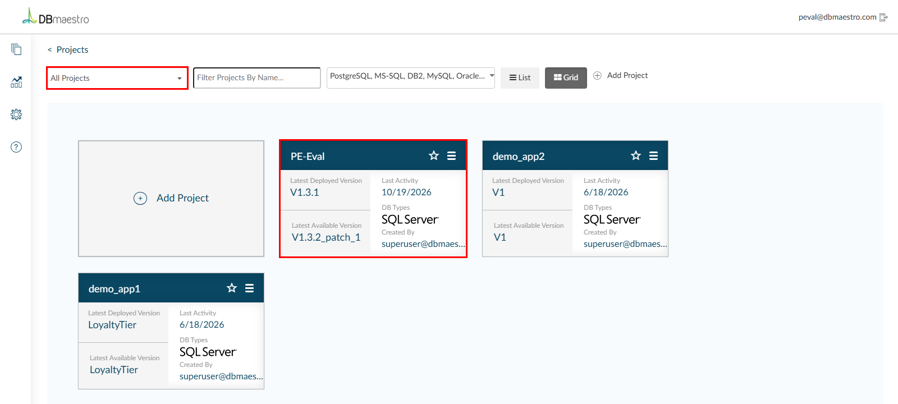

3. The project opens on the **Environments** tab. It shows the pipeline from left to right: **Dev → Release Source → Prod** (the environment *types*), with one card per environment: **Dev**, **QA** and **Production**. Each card shows:
   - its name and the **package version** currently deployed (`Ver ...`); the Dev card shows *Last Sync* instead, because Dev is managed by the Source Control client;
   - a **status icon** at the bottom left (green check = last operation succeeded; see the **Legend** at the top for the other states, including *Drifted*);
   - a **gear icon** (environment details) and a **☰ icon** (environment actions).

   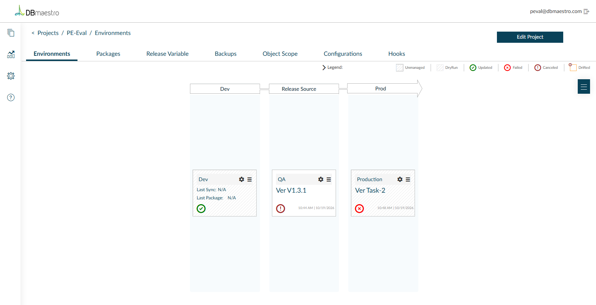

4. Click the **☰** icon on the **QA** card to see the actions you will use in the next exercises: **Upgrade**, **Validate**, **Pre Validate**, **Rollback**, **Apply Label**, **View Labels**, **Details**. Click anywhere outside the menu to close it.

   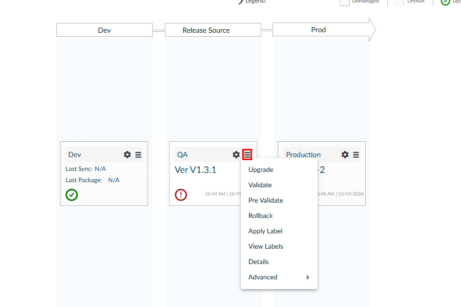

5. Click the **gear** icon on the **QA** card. The **Environment Activities** page opens, with four tabs:
   - **Activity:** every operation run on the environment, each with a **Details** link to its log (you will use it in exercises 3-6);
   - **Automation**, **Deployed Packages**;
   - **Databases:** the connection settings of the environment's database.

   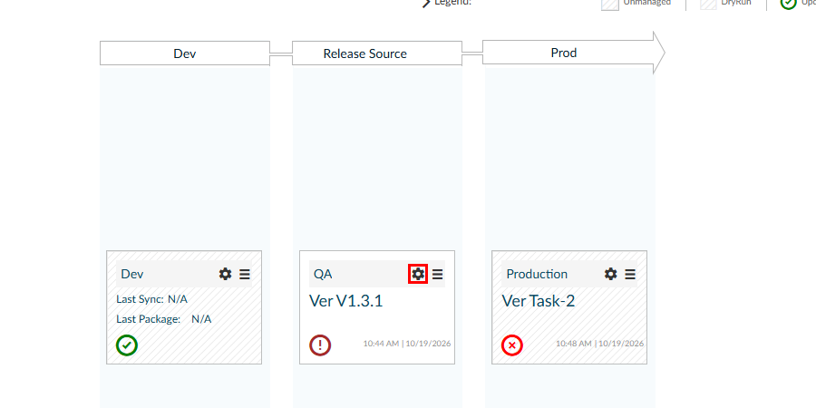

6. Open the **Databases** tab and check that the QA environment points to database `PE_Eval_QA` on the SQL Server provided by the instructor. Use the breadcrumb at the top (`Projects / PE-Eval / Environments`) to go back.

   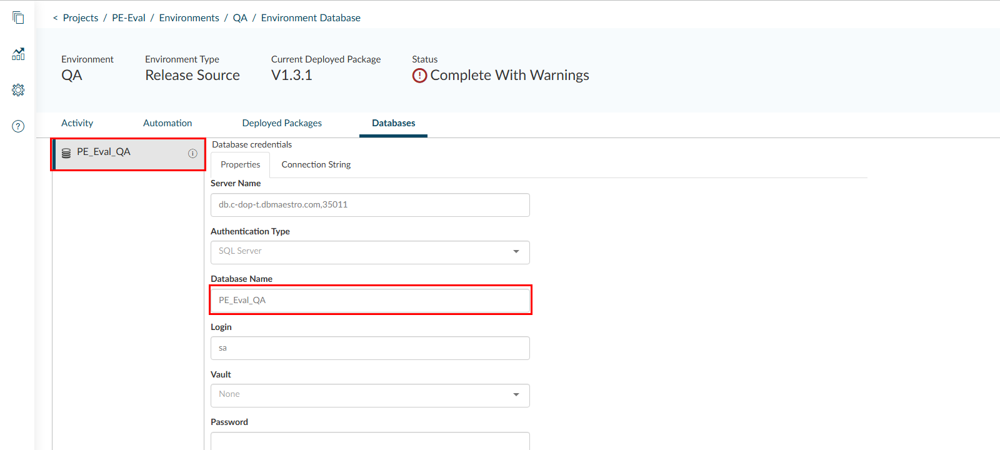

7. Open the **Packages** tab and click `V0`. Look at the package header: **Enabled**, **Ad-Hoc** (off), **Status: Closed** (a package is closed once it has been deployed) and the **PreCheck** icon. `V0` has no scripts: it is the empty baseline every project starts from.

   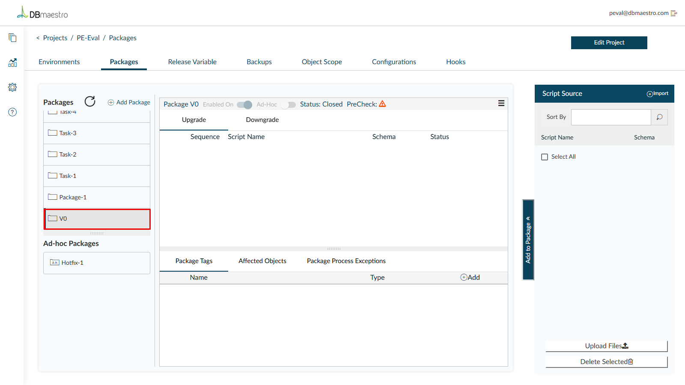

✅ **Expected result:** you can see the three environments in the pipeline, the database of each environment, and the package currently deployed to QA (`V0` at the start of the workshop).

---

<a id="exercise-1"></a>

## Exercise 1: Manual package by uploading scripts through the UI (create a table)

**Goal:** build a package by hand from upgrade and downgrade scripts.

Scripts: [`scripts/ex01/`](scripts/ex01/)

| File | Type |
|---|---|
| `01_create_customers.sql` | Upgrade |
| `01_drop_customers.sql` | Downgrade |

1. Download both files to your computer.
2. In the project, open the **Packages** tab and click **⊕ Add Package** (next to the *Packages* title).

   

3. In the **Add New Package** dialog, type `EX01` as **Package Name**, leave **Ad-Hoc Package** unchecked and click **Ok**. The new package appears in the list and is selected, with **Status: Opened** and no scripts.

   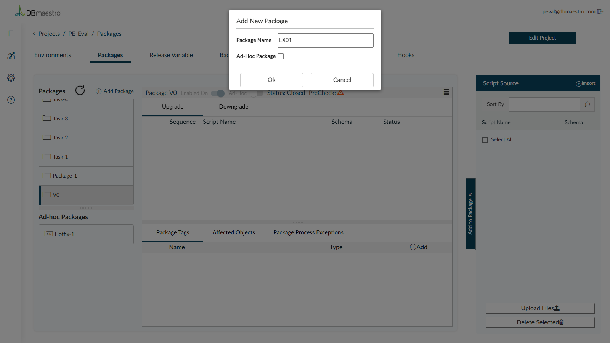

4. Upload the scripts. Scripts are first uploaded to the **Script Source** panel on the right, and from there added to the package. Click **Upload Files** at the bottom of the **Script Source** panel.

   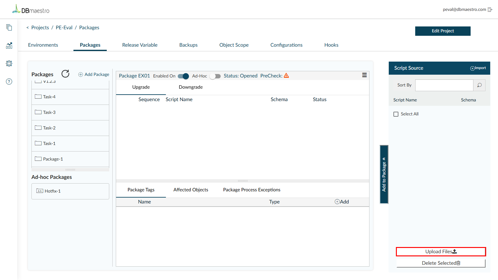

5. In the **Upload Files** dialog, keep **Databases Name** = `PE_Eval_QA` (the project's schema). Click **Drop files here, or click to Browse**, select both files and wait until each one shows **100%**. Click **Ok**.

   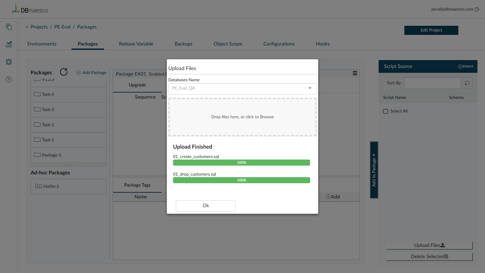

6. Both scripts now appear in the **Script Source** panel, on schema `PE_Eval_QA`. Click the 👁 icon next to a script to see its content.

   

7. Add the upgrade script. With the **Upgrade** tab of the package selected, check `01_create_customers.sql` in **Script Source** and click the vertical **Add to Package «** tab between the package and the Script Source panel.

   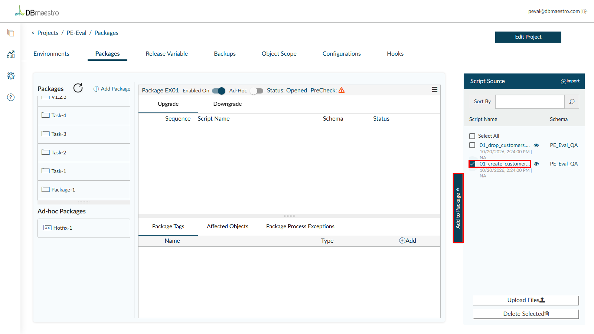

   The script moves to the package's **Upgrade** tab, with **Sequence** 1 and status **Enabled**:

   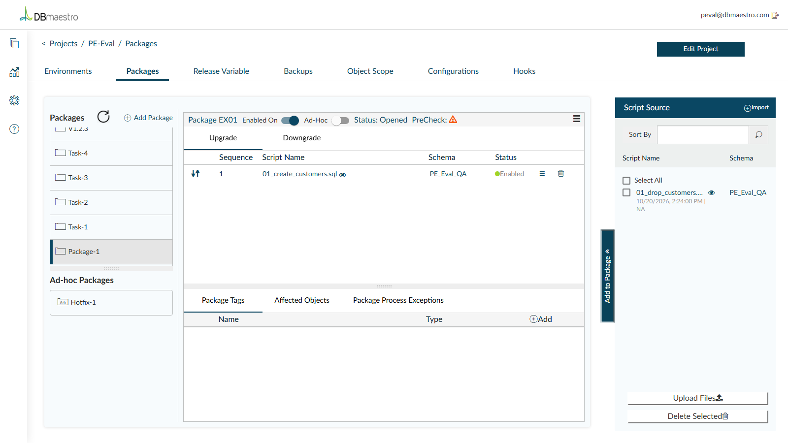

8. Add the downgrade script. Click the **Downgrade** tab of the package, check `01_drop_customers.sql` in **Script Source** and click **Add to Package «** again.

   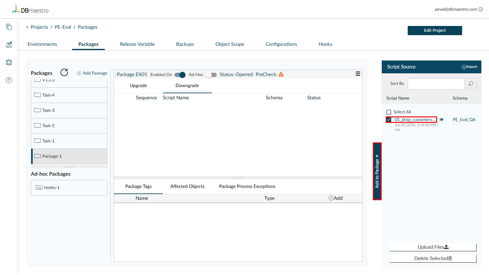

9. Check the result in both tabs. With several scripts, use the ⇅ arrows on the left of each row to change the execution order; the ☰ icon on each row has more options and the 🗑 icon removes the script from the package.

   

✅ **Expected result:** `EX01` has **Status: Opened** (not deployed), 1 script in the **Upgrade** tab and 1 in the **Downgrade** tab, both on schema `PE_Eval_QA`. Changes are saved as you make them; there is no Save button.

> ℹ️ **Note:** `EX01` is only for practicing how to build a package by hand: it is **not deployed** in any exercise. The `EX_CUSTOMERS` table reaches QA inside `EX02` (exercise 2), built from source control.

💡 **Think about it:** what happens if the package has no downgrade script? (We come back to this in exercise 5.)

---

<a id="exercise-2"></a>

## Exercise 2: Package from source control (Source Control client + GitHub Actions)

**Goal:** make a change in the Dev database, check it in with a Task ID, and let a GitHub Action build the DBmaestro package from it. You write no upgrade or downgrade script: DBmaestro generates both.

Scripts: [`scripts/ex02/`](scripts/ex02/)

| File | Run on |
|---|---|
| `dev_create_customers.sql` | `PE_Eval_DEV`: creates table `EX_CUSTOMERS` |
| `dev_create_proc_add_customer.sql` | `PE_Eval_DEV`: creates procedure `EX_ADD_CUSTOMER` |

**Part 1: change the Dev database and check it in**

1. On the workstation, open SSMS and run `dev_create_customers.sql` and then `dev_create_proc_add_customer.sql` on **`PE_Eval_DEV`** (see [How to run a script in a database](#how-to-run-a-script-in-a-database)).
2. Open the **DBmaestro Source Control** client (desktop icon). Check the header: **Project** = `PE-Eval`, **Branch** = `main`. Click **Refresh** (top left). The client compares the Dev database with the Git repository and lists the differences: `dbo.EX_ADD_CUSTOMER` (Procedure) and `dbo.EX_CUSTOMERS` (Table), both with **Change type** = **Added**. Click a row to see its **Database Version** next to the **Local Source Control Version** (empty, because the object is new).

   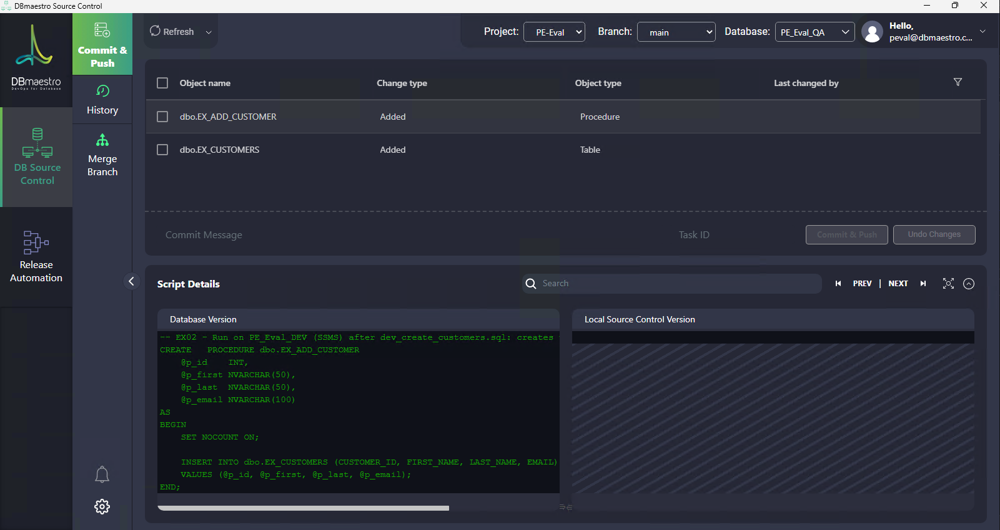

   > ℹ️ If the new objects do not appear, open the arrow next to **Refresh**, check **Force Refresh** and click **Refresh** again: it rescans every object instead of only the recently changed ones.

3. Check both objects, type a **Commit Message** (for example `EX02 table and procedure`) and **Task ID** = `EX02`, and click **Commit & Push**.

   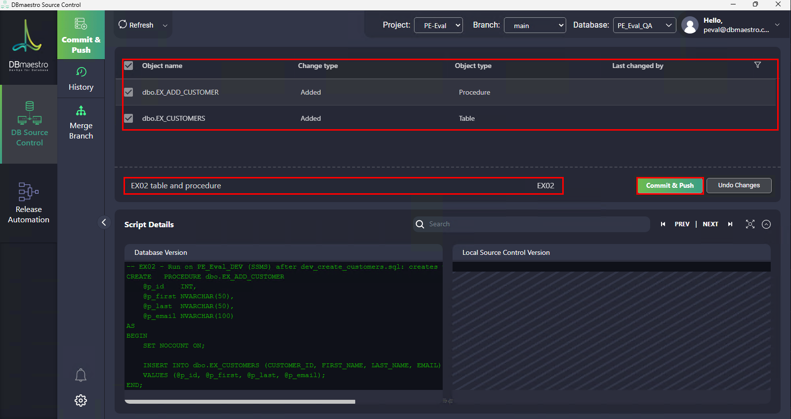

   After a few seconds the list is empty again: the objects are now in Git.

4. Open the repository on GitHub, [`dbmaestro-eval/pe-eval`](https://github.com/dbmaestro-eval/pe-eval), and look at the latest commit. Its message ends with **`TaskID: EX02`**, and it adds one creation script per object (`dbo/Procedures/Creation-Scripts/EX_ADD_CUSTOMER.sql`, `dbo/Tables/Creation-Scripts/EX_CUSTOMERS.sql`) plus DBmaestro metadata files.

   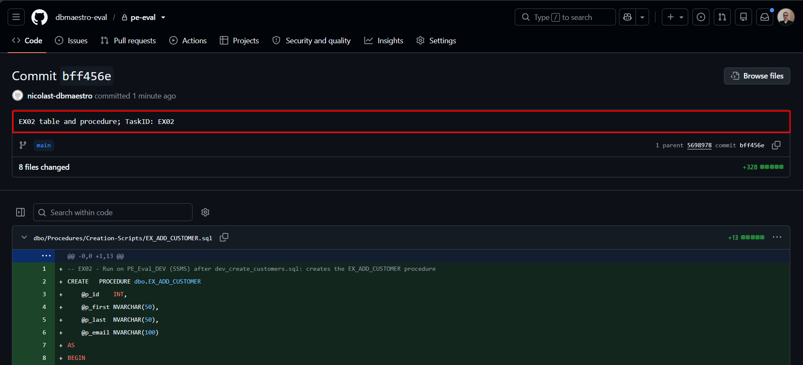

**Part 2: build the package with GitHub Actions**

5. In GitHub, open **Actions** and click **DBmaestro - Create Package** in the list of workflows. Click **Run workflow**. In the panel, leave **Use workflow from** = `main`, type **TaskID to package** = `EX02`, leave the other fields empty (the package name defaults to the Task ID) and click **Run workflow**.

   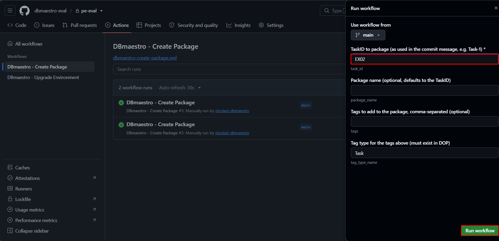

6. Click the new run to follow it (about a minute and a half). The jobs are **Prepare Parameters → Build Package → Validate Package** (*Tag Packages* is skipped when you give no extra tags). When the run shows **Success**, scroll down to the **Source Control Build Summary**: package `EX02`, project `PE-Eval`, environment `Dev`, version type `Tasks`, additional info `EX02`.

   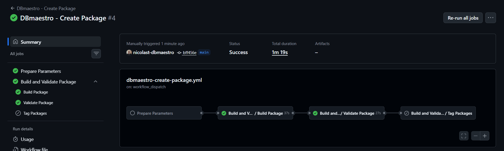

   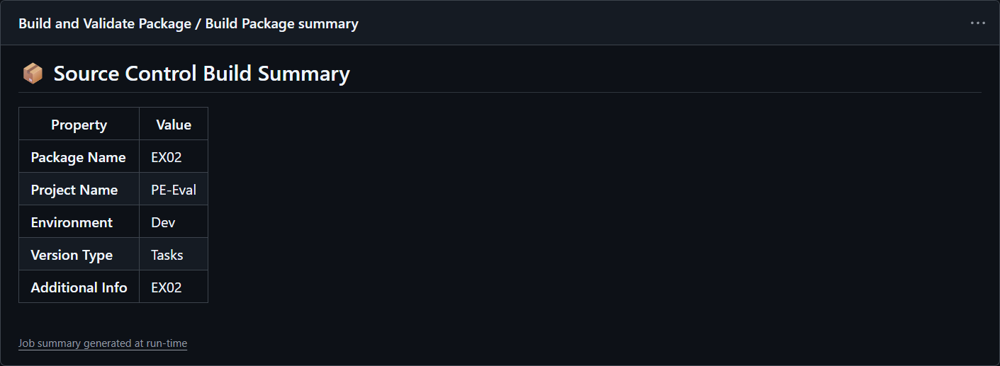

7. In DOP, open the **Packages** tab of PE-Eval (click the ⟳ refresh icon if `EX02` is not listed yet) and click `EX02`:
   - the **Upgrade** tab has one generated script, `Tasks-EX02-Labels-Upgrade-<date>.sql`;
   - **Package Tags** shows `EX02` with type `Task`: DOP tags task packages with their Task ID automatically.

   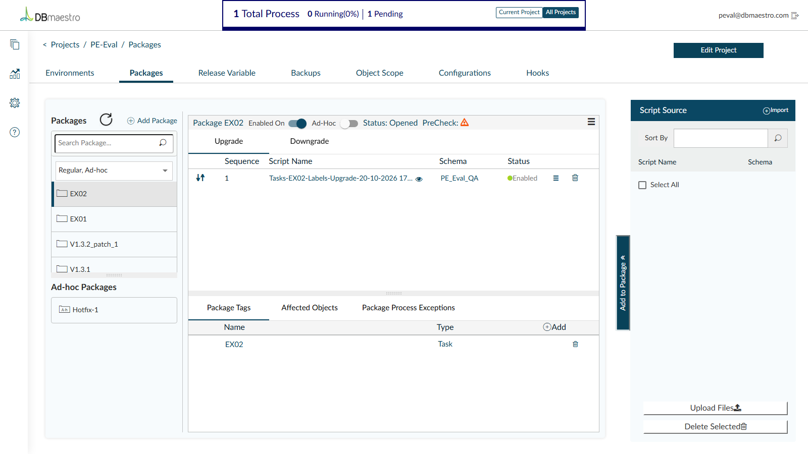

   Click the 👁 icon next to the script: it creates `EX_CUSTOMERS` and then `EX_ADD_CUSTOMER`, in dependency order. Click **Cancel** to close it.

   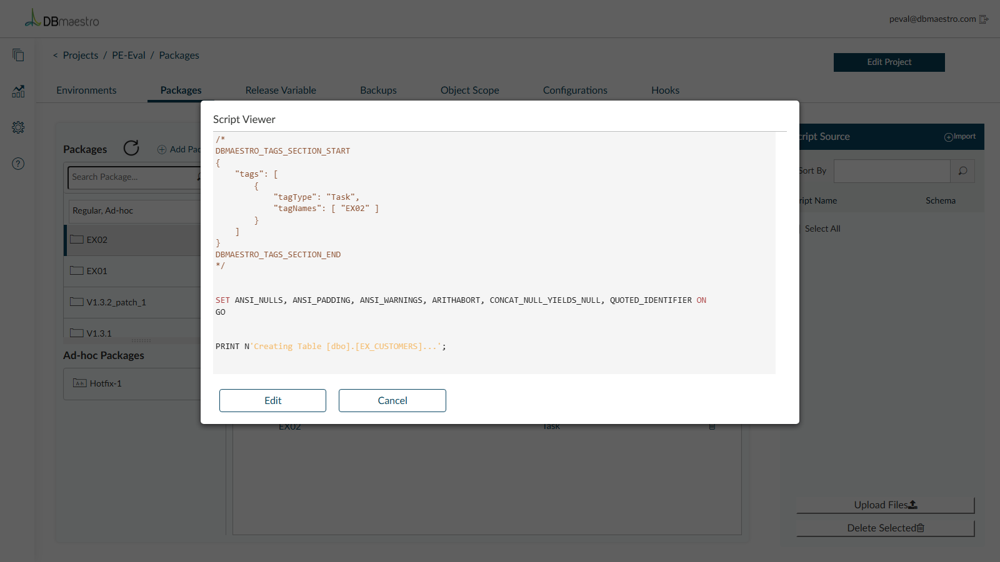

   The **Downgrade** tab has the generated `Tasks-EX02-Labels-Downgrade-<date>.sql`, which removes both objects.

   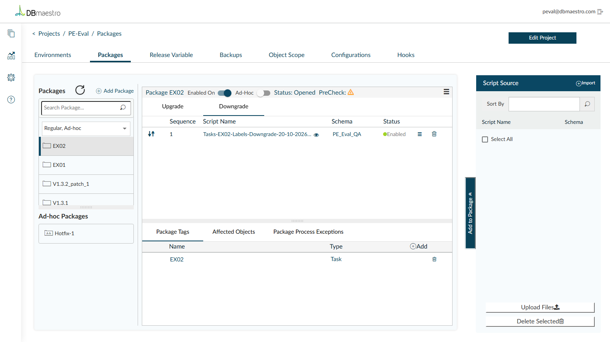

✅ **Expected result:** the Action run succeeds and `EX02` appears with **Status: Opened**, one generated upgrade script and one generated downgrade script, on schema `PE_Eval_QA`, tagged `EX02`.

💡 **Think about it:** compare with exercise 1. Where does the source of truth for the scripts live in each case? What do you get from Git and the Task ID (history, traceability from a ticket to a package, repeatability) that you do not get from uploading files through the UI?

---

<a id="exercise-3"></a>

## Exercise 3: Package pre-check

**Goal:** validate the package against the project policies before deploying it.

The **Create Package** Action already ran the pre-check of `EX02` (job *Validate Package*). Here you run it by hand for `EX01` and read the results of both.

1. In the **Packages** tab, select `EX01`.
2. Click the **☰** icon at the right end of the package header (the bar that reads *Package EX01 · Enabled · Ad-Hoc · Status · PreCheck*) and choose **PreCheck**. The pre-check runs in the background; there is no dialog. It takes a few seconds.

   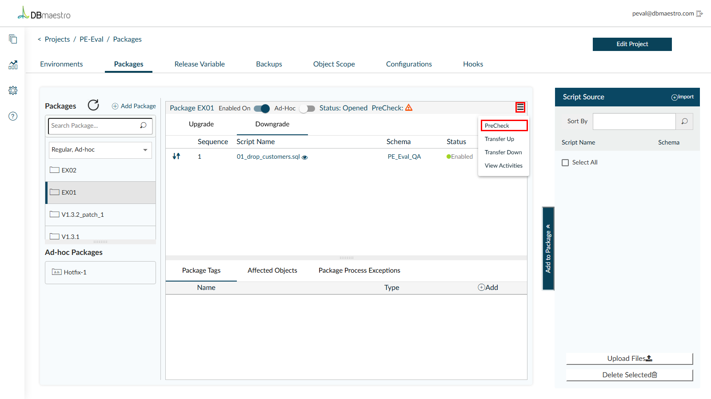

3. Open the result: click the package **☰** icon again and choose **View Activities**. The **Activity** panel lists the operations on the package; the newest one is **Pre-Check - EX01**, and just below it is **Pre-Check - EX02**, run by the Action. The icon shows the outcome (green = passed, orange = passed with warnings, red = failed). Click the **Details** link of **Pre-Check - EX01**.

   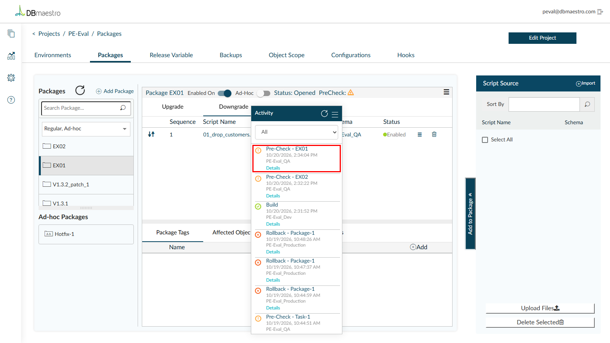

4. Read the **Action Log**. The policy engine ran (`Running policy for version EX01`, `Starting policy check`) and reported a warning on the downgrade script:

   `Policy Engine Violations: In Script 01_drop_customers.sql, Warning: 'Data Loss Risk', 'Drop Table is not allowed', 'Contains Drop Table'`

   Click **Pre check** under **Reports** for the full report, and the ⊗ icon to close.

   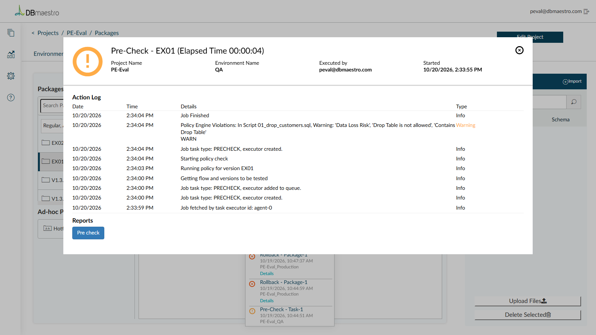

5. Open the **Details** of **Pre-Check - EX02**. The same warning is now on the **generated** downgrade script, `Tasks-EX02-Labels-Downgrade-<date>.sql`:

   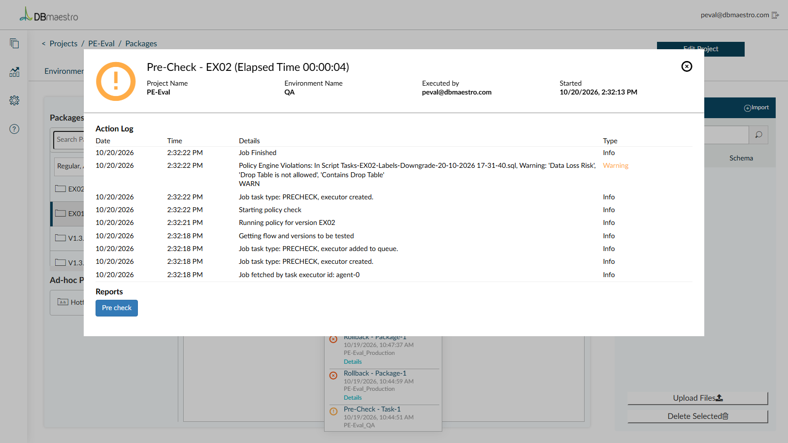

✅ **Expected result:** `EX01` and `EX02` pass the pre-check (`Job Finished`), each with a *Drop Table* warning on its downgrade script. A warning does not block the deployment; an error would.

> ℹ️ The pre-checks also appear in the **Activity** tab of the QA environment (gear icon on the card), because the pre-check is evaluated against the first environment after Dev.

💡 **Think about it:** which policy rules are active in the project? Which ones block and which ones only warn? Why would a downgrade script that drops a table deserve a warning, even when DBmaestro generated it?

---

<a id="exercise-4"></a>

## Exercise 4: Deployment to QA with GitHub Actions

**Goal:** deploy a package with a pipeline and read the deployment log.

Scripts: [`scripts/ex04/`](scripts/ex04/)

1. In GitHub, open **Actions → DBmaestro - Upgrade Environment** and click **Run workflow**. Choose **Environment to upgrade** = `QA`, type **Package name(s)** = `EX02`, leave **tag_name** empty and click **Run workflow**.

   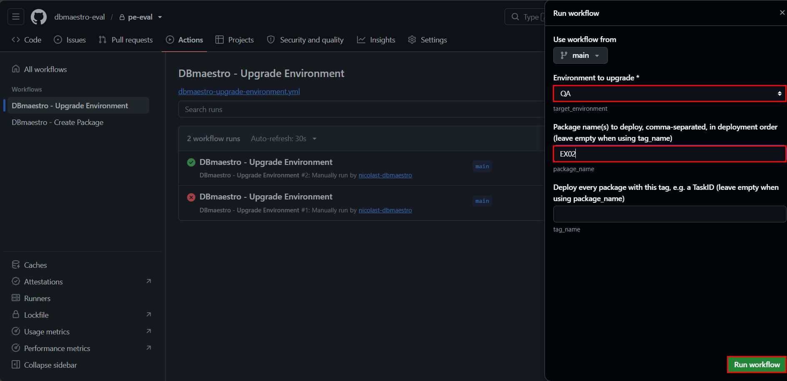

   > ℹ️ Instead of a package name you can give a **tag**, for example a Task ID: the Action then deploys every package with that tag. Use one or the other, not both.

2. Follow the run (about a minute and a half) until it shows **Success**. The job **Upgrade Environment (EX02)** ran the deployment.

   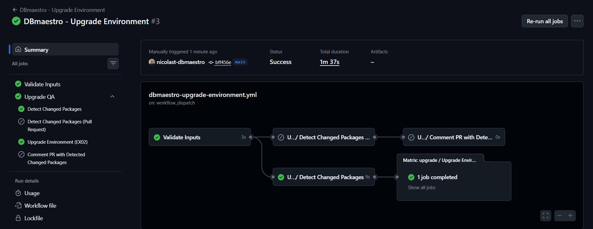

3. In DOP, open the **Environments** tab: the QA card shows `Ver EX02` and a green status icon.

   

4. Review the execution log: click the **gear** icon on the QA card; in the **Activity** tab, the newest entry is **Upgrade - EX02**. Click its **Details** link.

   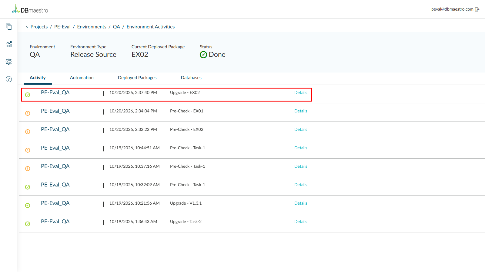

   The log is shown newest first. Read it from the bottom up and find:
   - `Policy Engine task: ...`: policies are evaluated again before deploying;
   - `Pre-Validation: Comparing schema 'PE_Eval_QA' to label 'V0-post'` (the snapshot taken after the previous deployment; the screenshot shows another version): DBmaestro checks that the database still matches what it deployed last time (more on this in exercise 6);
   - `Starting the script execution: Tasks-EX02-Labels-Upgrade-<date>.sql` … `Script excution success`;
   - `Updating source control`;
   - `Label Created: 'EX02-post'`: a snapshot of the schema after the deployment, used by later validations;
   - `Target env updated 'EX02'`, `Deployment request completed`.

   Click **Show SQL Console Output** to see what SQL Server returned.

   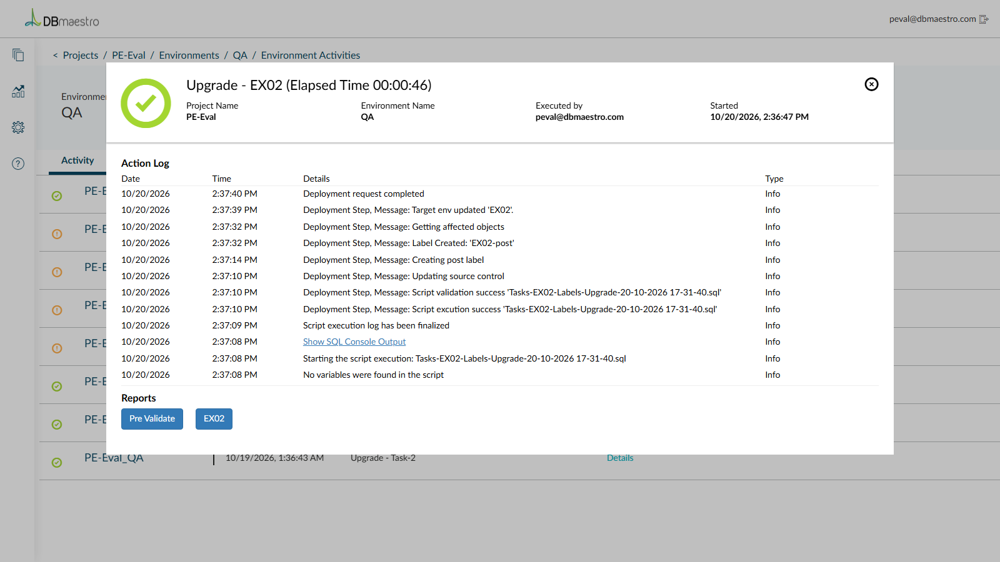

5. Run `verify_qa.sql` on `PE_Eval_QA` (see [How to run a script in a database](#how-to-run-a-script-in-a-database)). It calls the procedure and lists the table:

   ```
   CUSTOMER_ID FIRST_NAME LAST_NAME EMAIL        CREATED_AT
   ----------- ---------- --------- ------------ ---------------------------
   1           Ana        Perez     ana@test.com 2026-10-20 17:38:44.0197580
   ```

✅ **Expected result:** `EX02` is deployed to QA (`Ver EX02` on the card), the log shows the script executed successfully, and in QA the procedure inserts the row.

💡 **Think about it:** the Action only offers QA and Production as targets. Why is Dev not one of them? (Hint: who changes Dev, and how does a change get from Dev into a package?)

---

<a id="exercise-5"></a>

## Exercise 5: Rollback

**Goal:** undo a deployment with the package's downgrade script, and deploy it again from the DOP UI.

Scripts: [`scripts/ex05/`](scripts/ex05/)

1. In DOP, on the **QA** card, click **☰ → Rollback**.

   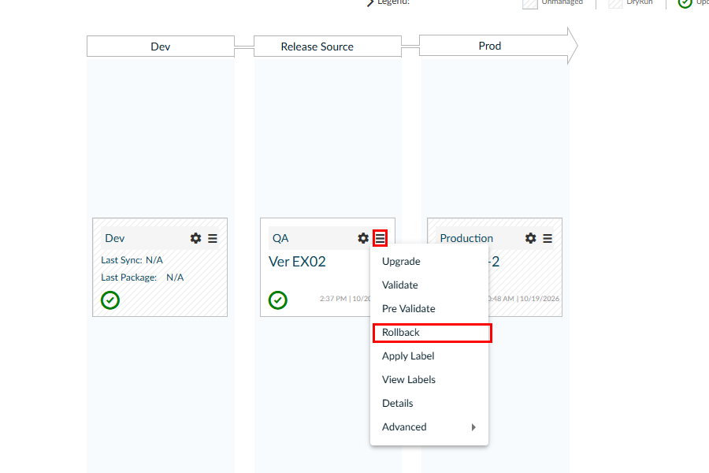

2. The **Rollback** dialog shows the **Current Environment Version** (`EX02`) and, under **Available Packages**, the packages deployed to QA. Type `EX02` in **Filter text**, click **Filter**, and click the ⊕ icon next to `EX02` so it moves to **Selected Packages (1)**. Leave **Backup** and **Auto Restore** at their default values. Optionally check **View The Script Before Running** to review the downgrade script first. Click **Rollback**.

   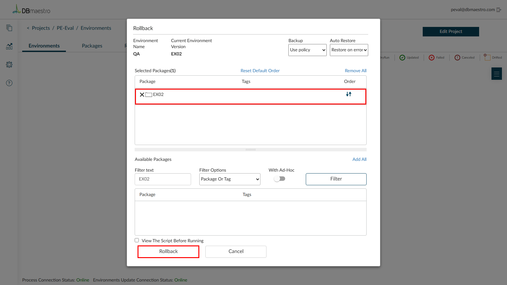

3. Wait for the operation to finish (about half a minute). Open the **gear** icon of QA: the newest activity is the rollback. Its **Details** show the execution of the generated downgrade script and a new label, `EX02__Rollback_To_V0_<hash>-post`.

   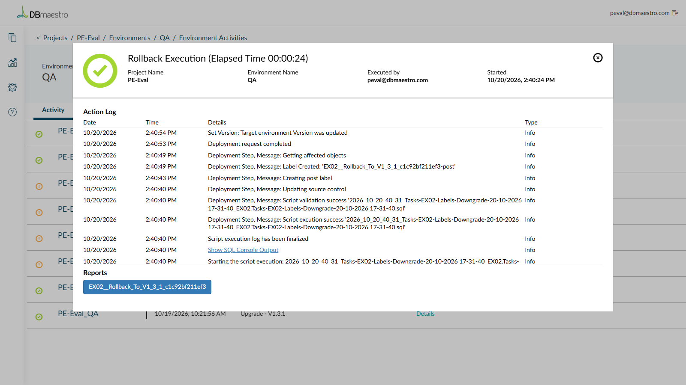

   Back on the **Environments** tab, the QA card shows the previous version followed by the rollback in parentheses, `Ver V0 (EX02__Rollback_To_V0_...)` (the screenshot was taken on a QA that had another version before `EX02`): QA is back where it was before `EX02`, and the rollback is recorded as its own operation.

   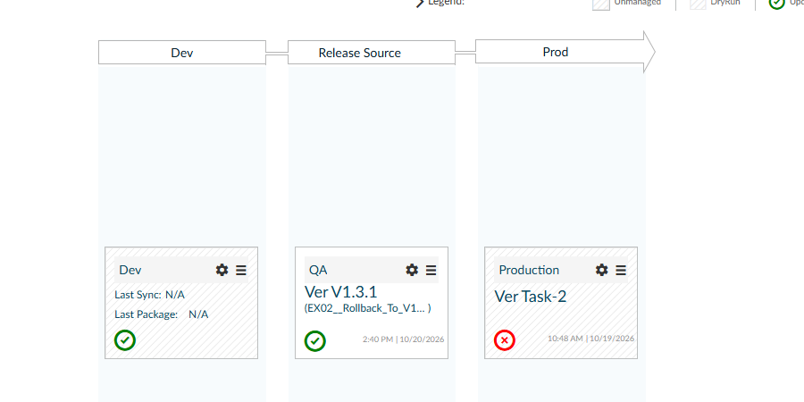

4. Run `verify_rollback.sql` on `PE_Eval_QA` and confirm it returns **no rows**: `dbo.EX_ADD_CUSTOMER` and `dbo.EX_CUSTOMERS` no longer exist.

   ```
   name type_desc modify_date
   ---- --------- -----------

   (0 rows affected)
   ```

5. Bring QA back to `EX02`, this time from the DOP UI instead of GitHub Actions: on the QA card click **☰ → Upgrade**.

   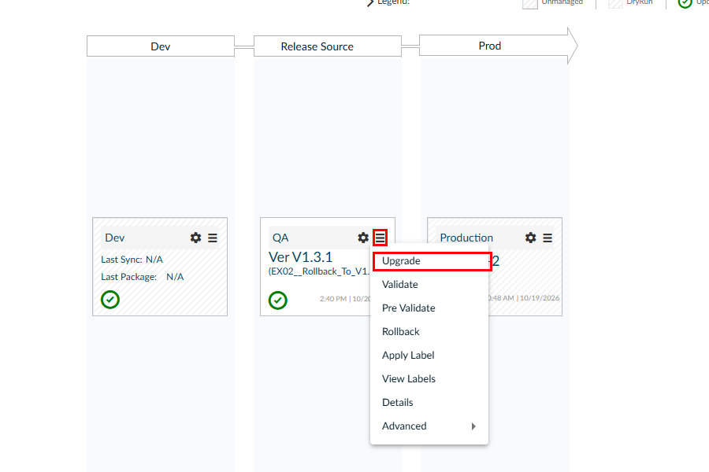

   In the **Upgrade** dialog, filter by `EX02` and click the ⊕ icon next to it:

   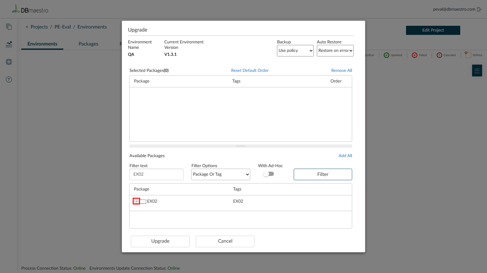

   `EX02` moves to **Selected Packages (1)**. Leave **Backup** = `Use policy` and **Auto Restore** = `Restore on error`, and click **Upgrade**. When it finishes, the QA card shows `Ver EX02` again.

   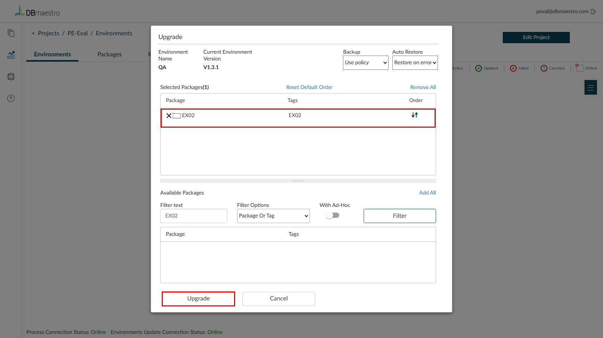

✅ **Expected result:** after the rollback QA is back on `V0` and the EX02 objects are gone; after the new upgrade QA is on `EX02` again. Dev and Production were not affected.

💡 **Think about it:** what would happen with the rollback if `EX02` had no downgrade script? Note that the downgrade drops `EX_CUSTOMERS` **with its data**: the row inserted in exercise 4 is lost. How would you protect the data?

---

<a id="exercise-6"></a>

## Exercise 6: Drift detection on a stored procedure (QA)

**Goal:** see what happens when someone changes an object by hand in a pipeline environment, and an official change to the same object arrives later.

Scripts: [`scripts/ex06/`](scripts/ex06/)

<a id="exercise-6-part-a"></a>

### Part A: create and detect the drift

1. **Create the drift:** connect directly to `PE_Eval_QA`, outside DBmaestro, and run `qa_manual_drift.sql`. It simulates a manual "hotfix": procedure `EX_ADD_CUSTOMER` now stores the email in uppercase.

2. In DOP, on the **QA** card click **☰ → Validate**.

   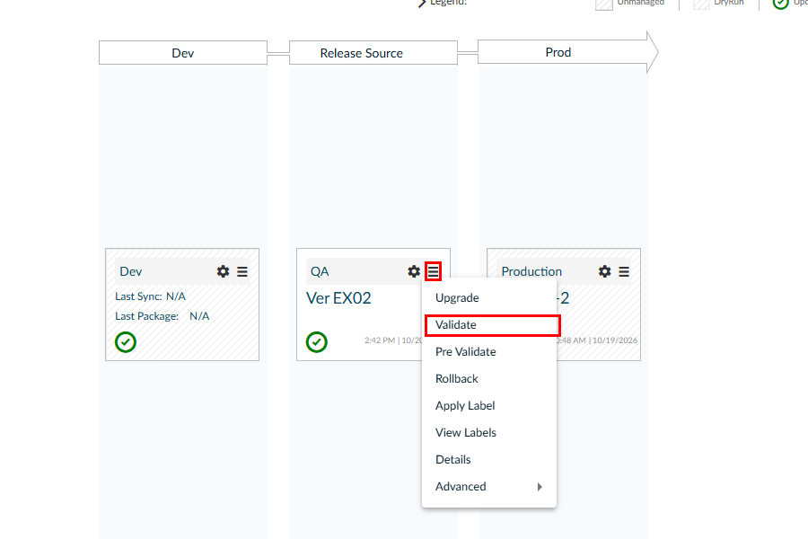

3. In the **Validate** dialog, keep **By Label** and open the second list. It shows the labels DBmaestro created on this environment; choose **`EX02-post`**, the snapshot taken right after `EX02` was deployed.

   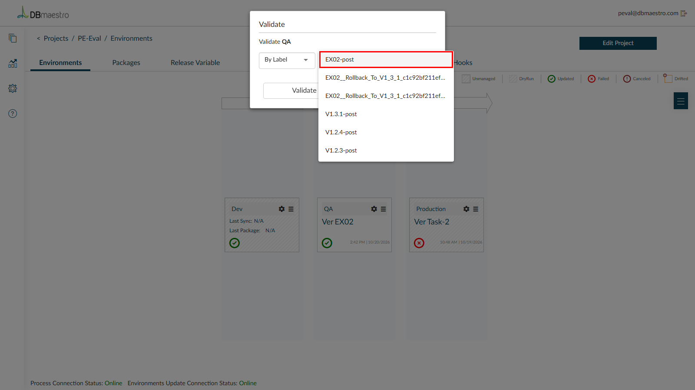

   Click **Validate**.

   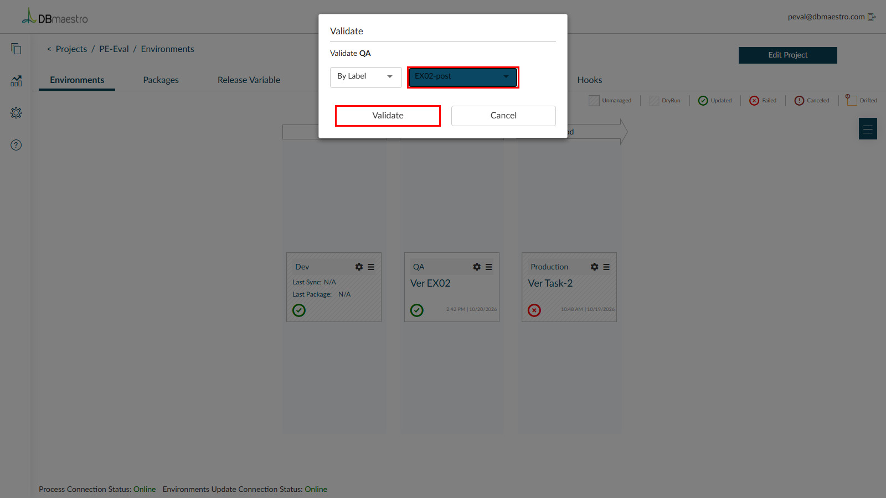

4. After a few seconds the QA card is marked as drifted (orange frame and marker, see the **Legend**) with a red status icon.

   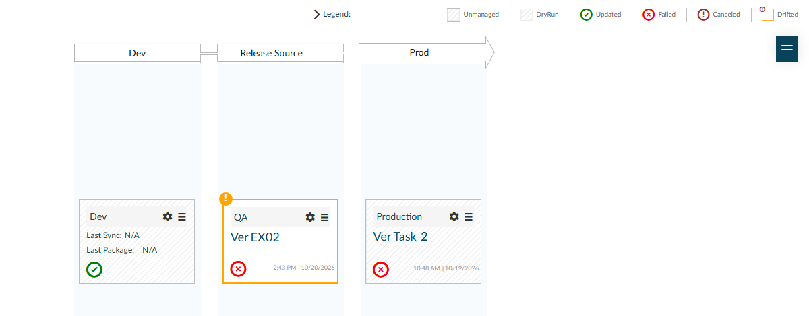

5. Click the **gear** icon of QA. The newest activity is **Validate - EX02** with a red icon, and the environment **Status** is **Failed**. Click **Details**.

   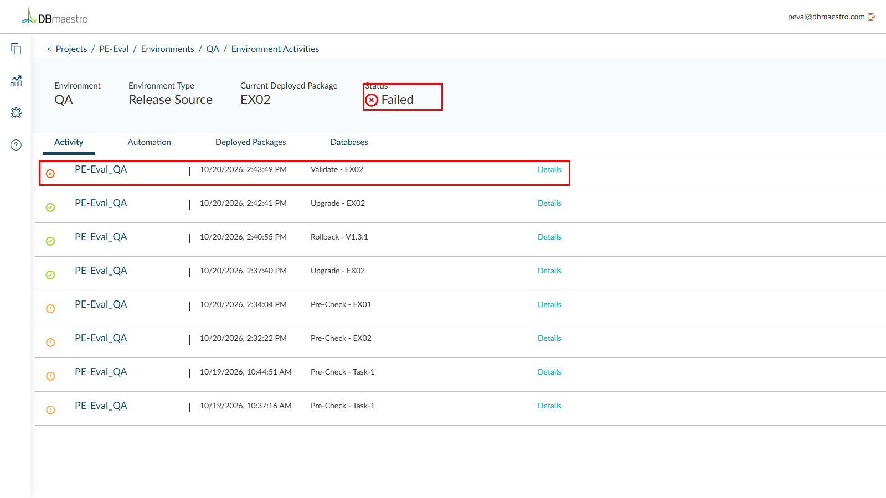

6. The log says:

   `Drift detected on schema 'PE_Eval_QA' in Environment 'QA' has [1] objects different than on label 'EX02-post'. Please consider rolling back to the current environment version`

   Click **Validation** under **Reports** (it opens in a new browser tab).

   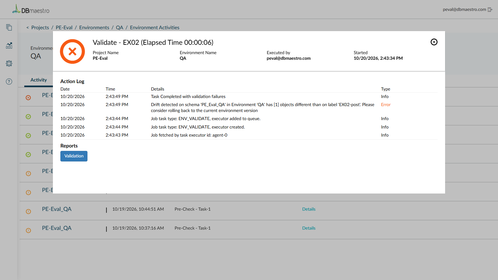

7. The **Impact Analysis Report** opens. On the **Structure Analysis (1)** tab, `dbo.EX_ADD_CUSTOMER` (Procedure) has status **Changed**. Click the 👁 icon under **View Changes**.

   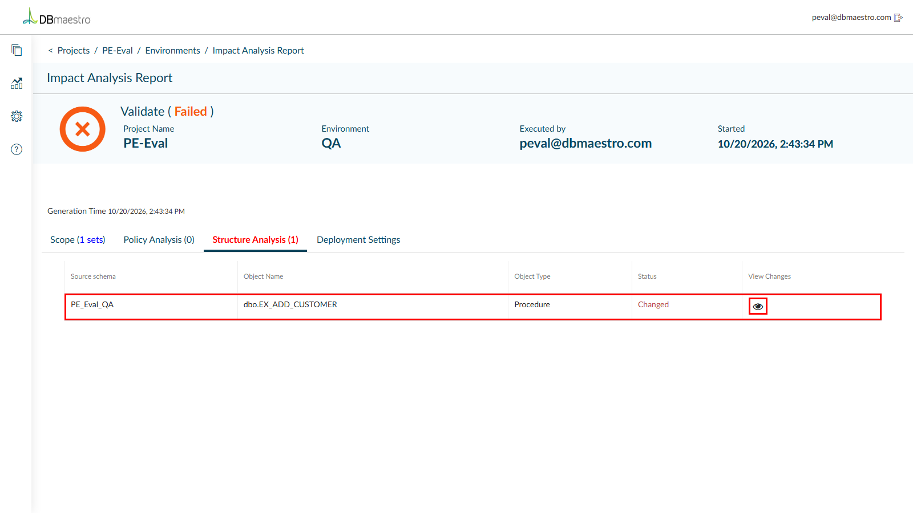

8. The **Object Drift Viewer** compares the procedure as it is in the database (**Actual**, left) with what DBmaestro deployed (**Expected**, right). The highlighted lines show the manual change, `UPPER(@p_email)`, and the different header comment of the hotfix script (comments written before `CREATE PROCEDURE` are stored as part of the procedure). Click **Cancel** to close it.

   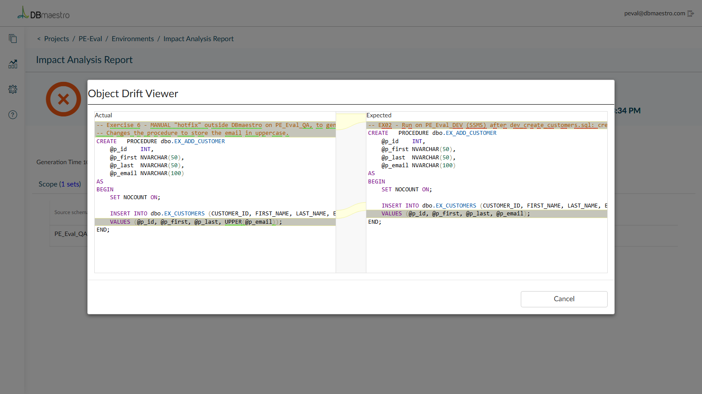

<a id="exercise-6-part-b"></a>

### Part B: an official change meets the drift

9. **Official change through source control:** run `dev_alter_proc_add_customer.sql` on **`PE_Eval_DEV`**. The new version of the procedure makes the email mandatory and stores it in lowercase.

10. In the **Source Control** client click **Refresh**. `dbo.EX_ADD_CUSTOMER` appears with **Change type** = **Changed**; the **Script Details** compare the new Dev version (left) with the version in Git (right).

    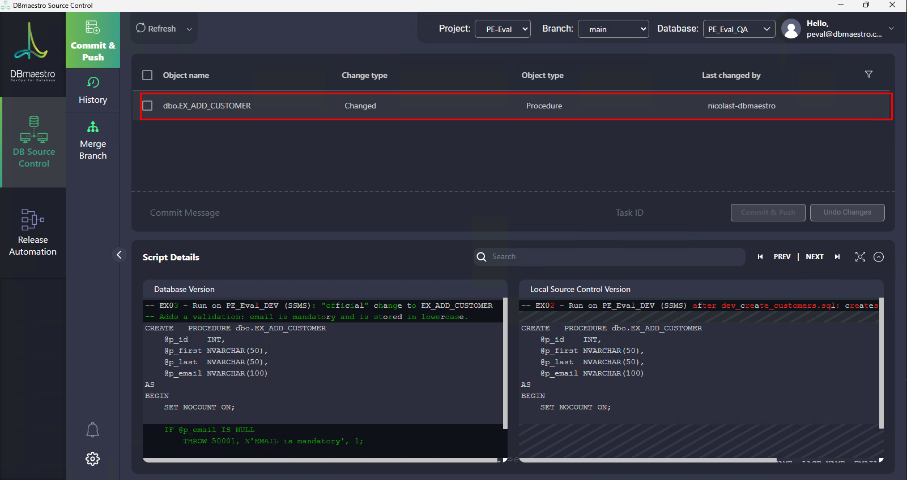

    Check it, type a **Commit Message** (for example `EX03 EX_ADD_CUSTOMER requires email, stores it in lowercase`) and **Task ID** = `EX03`, and click **Commit & Push**.

    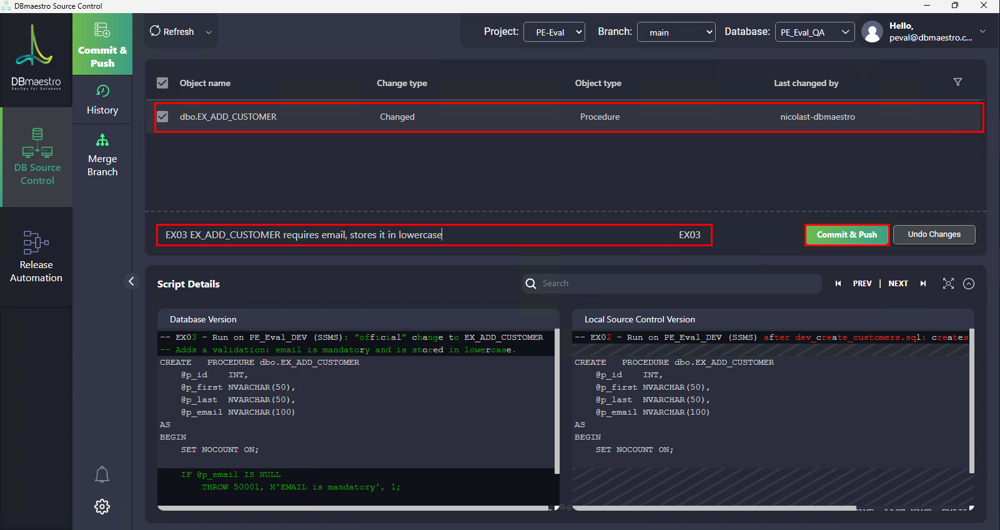

11. In GitHub run **Actions → DBmaestro - Create Package** with **TaskID** = `EX03`, just like in exercise 2. When it succeeds, `EX03` appears in the DOP **Packages** tab with one generated upgrade script (an `ALTER PROCEDURE`) and one generated downgrade script. Its pre-check (**Pre-Check - EX03** in the QA activity) passes **without warnings**: the policies look at the scripts, not at the state of the database.

    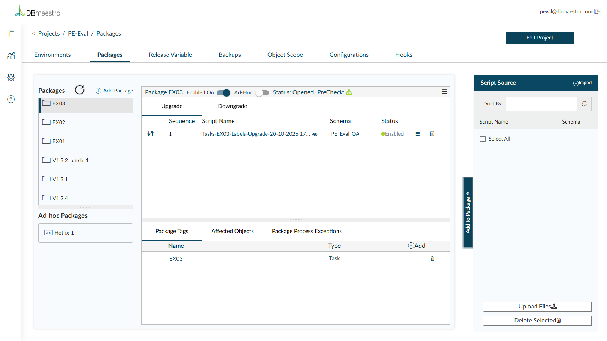

12. Try to deploy it: run **Actions → DBmaestro - Upgrade Environment** with **Environment** = `QA` and **Package name(s)** = `EX03`, as in exercise 4. This time the run ends in **Failure** at the job **Upgrade Environment (EX03)**.

    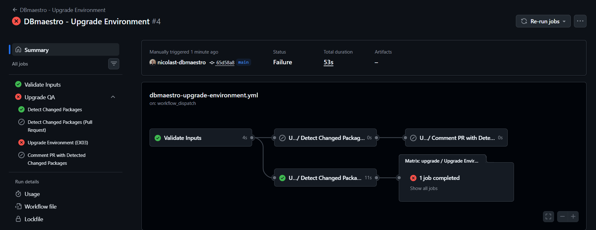

13. In DOP, click the **gear** icon of QA: the newest activity, **Upgrade - EX03**, failed, and the QA card still shows `Ver EX02`. Click its **Details**.

    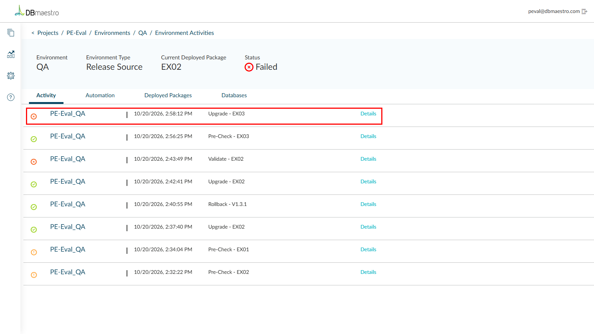

    The log shows why:
    - `Pre-Validation: Comparing schema 'PE_Eval_QA' to label 'EX02-post'.`
    - `Deployment request failed, message: Failed Validate version labels by objects`

    DBmaestro refused to run the `EX03` script because QA no longer matches what it deployed.

    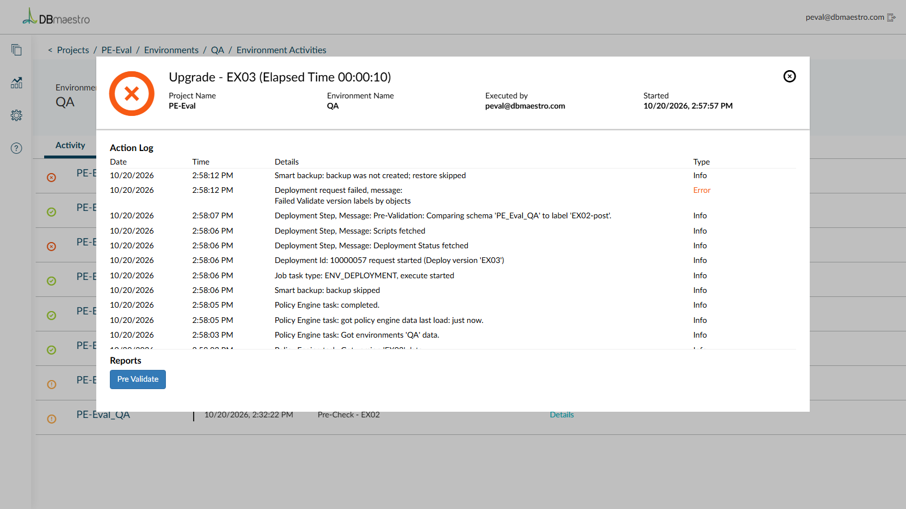

<a id="exercise-6-part-c"></a>

### Part C: fix the drift and deploy

14. **Fix the drift:** run `qa_revert_drift.sql` on `PE_Eval_QA` to restore the `EX02` version of the procedure.

15. Run **☰ → Validate** on QA again, **By Label** `EX02-post`, as in steps 2-3. The new **Validate - EX02** activity is green and its log reads `Schema 'PE_Eval_QA' on environment 'QA' Validated vs 'PE_Eval_QA' on label 'EX02-post'.`

    

16. Run **Actions → DBmaestro - Upgrade Environment** with `QA` and `EX03` again (or click **Re-run jobs** on the failed run). This time it succeeds, and the QA card shows `Ver EX03`.

    

    

17. Optional: in `PE_Eval_QA`, run `EXEC dbo.EX_ADD_CUSTOMER 2, N'Bob', N'Lee', N'Bob@Test.COM';` and check that the email was stored as `bob@test.com`. Calling it with `NULL` as email fails with `EMAIL is mandatory`.

✅ **Expected result:**
- In Part A, Validate fails and the report shows that `EX_ADD_CUSTOMER` in QA does not match label `EX02-post`.
- In Part B, the upgrade with `EX03` is blocked by the pre-validation (`Failed Validate version labels by objects`) and nothing is executed.
- In Part C, after reverting the drift, Validate passes and `EX03` deploys to QA without issues.

💡 **Think about it:** if DBmaestro had not blocked the upgrade in step 12, the `EX03` change would have overwritten the manual hotfix without anyone noticing. What if the hotfix was important? The right way to keep it is to make it in Dev, check it in with a Task ID and let it travel in a package.

---

<a id="summary"></a>

## Summary

| # | Topic | Package | Tools | Time |
|---|------|---------|-------|------|
| 0 | Getting oriented | V0 | DOP | 10' |
| 1 | Manual package (table) | EX01 | DOP | 15' |
| 2 | Package from source control (table + stored procedure) | EX02 | SSMS, Source Control client, GitHub Actions | 25' |
| 3 | Pre-check | EX01, EX02 | DOP | 10' |
| 4 | Deploy to QA | EX02 | GitHub Actions, DOP | 15' |
| 5 | Rollback and redeploy | EX02 | DOP | 15' |
| 6 | Stored procedure drift (QA) | EX03 | SSMS, DOP, Source Control client, GitHub Actions | 30' |

<a id="repository-structure"></a>

## Repository structure

```
README.md            this guide
scripts/
  ex01/  Manual package: EX_CUSTOMERS table (upgrade + downgrade)
  ex02/  Changes to run on PE_Eval_DEV: EX_CUSTOMERS table + EX_ADD_CUSTOMER procedure
  ex04/  Deployment verification on QA
  ex05/  Rollback verification
  ex06/  Drift on QA (manual hotfix and revert) + the EX03 change to run on PE_Eval_DEV
images/              UI screenshots, taken on PE-Eval
.github/workflows/
  dbmaestro-create-package.yml       DBmaestro - Create Package (build by Task ID + pre-check)
  dbmaestro-upgrade-environment.yml  DBmaestro - Upgrade Environment (QA / Production)
.dbmaestro/, Database/, dbo/         maintained by DBmaestro Source Control: do not edit by hand
```
